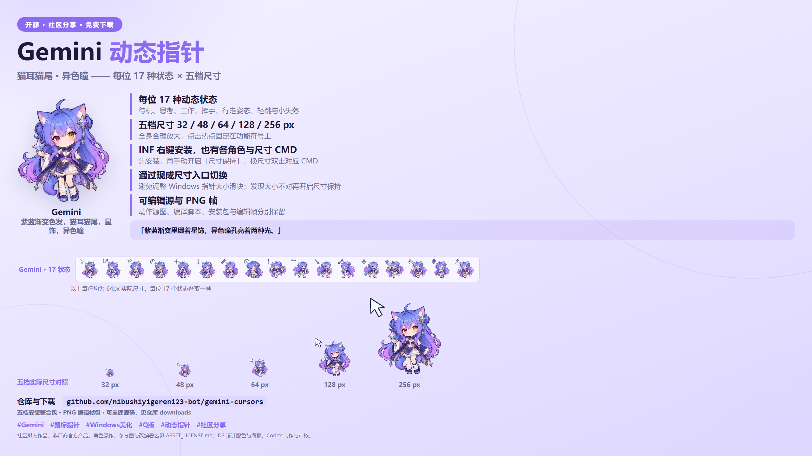

# Gemini 动态鼠标指针

## v1.1.0：原版更新与新增放大版

[下载完整原版](https://github.com/nibushiyigeren123-bot/gemini-cursors/releases/download/v1.1.0/gemini-cursors-original-install-v1.1.0.zip) · [下载完整放大版](https://github.com/nibushiyigeren123-bot/gemini-cursors/releases/download/v1.1.0/gemini-cursors-large-arrow-install-v1.1.0.zip) · [本次全部下载](https://github.com/nibushiyigeren123-bot/gemini-cursors/releases/tag/v1.1.0)

原版保留五档32/48/64/128/256px；新增放大版提供六档组合画布32/48/64/72/128/256px。72px组合保留各自原版48px人物图层，功能符号更大，人物在右下方分开排布。原版名字与安装目录保留；放大版位于[large-arrow](large-arrow/README.md)，使用独立方案与目录，同仓库共存。

两版同步修正小尺寸人物颜色发浅的加载问题，角色美术和原版动画文件保持。完整解压对应ZIP，运行本包“应用”CMD；原先正在运行的本版尺寸保持器会更新并恢复运行，原先停止则保持停止。需要持续保持，再运行同包“尺寸保持_开启.cmd”。INF或系统设置直接选方案仍走系统文件加载，随后需本版保持器重新载入。普通应用默认不新增后台；尺寸保持属于可选功能，龙娘本次也补齐该可选入口。

要确定返回原版，请运行原版应用CMD，或放大版“切回_角色_原版”入口。“恢复安装前指针”只返回上一套方案。全部包含对应可编辑源图、PNG帧、生成器、安装与恢复入口；正常使用无需Python。

### 放大版介绍视频

- Gemini：[26秒介绍视频](https://github.com/nibushiyigeren123-bot/gemini-cursors/releases/download/v1.1.0/gemini-large-arrow-introduction.mp4) · [字幕](https://github.com/nibushiyigeren123-bot/gemini-cursors/releases/download/v1.1.0/gemini-large-arrow-introduction.srt)

用户实际使用反馈继续收集；以下为原版设计、来源与历史资料，旧发行保留。

---

> **v1.0.1 安装兼容修复**：[完整安装包](https://github.com/nibushiyigeren123-bot/gemini-cursors/releases/download/v1.0.1/gemini-cursors-install-v1.0.1.zip) · [可编辑源码](https://github.com/nibushiyigeren123-bot/gemini-cursors/releases/download/v1.0.1/gemini-cursors-source-v1.0.1.zip) · [PNG帧](https://github.com/nibushiyigeren123-bot/gemini-cursors/releases/download/v1.0.1/gemini-cursors-png-frames-v1.0.1.zip)。升级步骤和旧系统说明见 [兼容修复说明](WIN10_COMPATIBILITY.md)。

Gemini 的社区 Q 版 Windows 指针，每位 **17 种状态 × 32 / 48 / 64 / 128 / 256 px 五档尺寸**。同公司的角色放在同一仓库，每位都能单独选择。

## 下载和安装

下载 [完整安装包](https://github.com/nibushiyigeren123-bot/gemini-cursors/releases/download/v1.0.1/gemini-cursors-install-v1.0.1.zip)，完整解压到本地目录。

1. 双击 `应用_Gemini_64px.cmd`，或选择其他角色、其他尺寸的同名 CMD。第一次会保存安装前的 Windows 指针设置。
2. 如需保持所选实际尺寸，手动运行一次 `尺寸保持_开启.cmd`。以后更换大小，双击对应尺寸 CMD。
3. 也可右键某个 `安装_角色_尺寸.inf` → 安装，然后在 Windows 鼠标属性 → 指针中选择对应 `角色 AI 尺寸px` 方案。

32/48 px 较小，64 px 为默认选择，128/256 px 适合希望看清角色的场景。大小通过所提供的尺寸入口切换；Windows 的指针大小滑块可能重置实际尺寸，遇到时重新开启尺寸保持。

`尺寸保持_关闭.cmd` 关闭后台保持；`尺寸保持_卸载.cmd` 移除它的登录项。`恢复安装前指针.cmd` 恢复这个包首次记录的**全局**指针选择，不会卸载其他包。各家公司安装目录与保持程序分开；Windows 当前指针选择仍只有一套。

保持程序从附带 C# 源码在本机编译，不附带预编译 EXE。普通安装不会自动启动保持程序。本次验证没有切换用户当前系统指针；不能据此声称已在你的当前桌面实测长期保持效果。

## 动画与编辑

动作来自每位角色九张绘制姿态，再由脚本合成八相位的呼吸、微倾、摆动及轻跳。行走使用行走姿态和二维摆动；**不是八张独立逐帧绘制的步态动画**。17 状态均保留标准功能符号和固定点击热点。

- [4:3 海报](previews/poster-4x3.png) 和 [16:9 海报](previews/poster-16x9.png)：2400×1800 / 2560×1440，分别排版、按公司配色。
- [展示视频](previews/showcase.mp4)：全部角色、17 状态与五档尺寸；视频编辑轨在完整工程中单独保存。
- `source/characters/角色/pose-sources`：透明动作源；`source/build_cursors.py`：重建脚本；[动作参数](source/action-recipe.json)。
- [gemini-cursors-png-frames-v1.0.1.zip](https://github.com/nibushiyigeren123-bot/gemini-cursors/releases/download/v1.0.1/gemini-cursors-png-frames-v1.0.1.zip)：所有状态的可编辑 PNG 帧，安装时无需下载。
- [gemini-cursors-source-v1.0.1.zip](https://github.com/nibushiyigeren123-bot/gemini-cursors/releases/download/v1.0.1/gemini-cursors-source-v1.0.1.zip)：当前透明源、参数、编译及安装源码。完整原始参考、生成历史和视频各轨另存本地正式工程档案。

重建：Python 安装 `requirements.txt` 中依赖后，在解压目录运行 `python source/build_cursors.py`。它重建 ANI、PNG 帧、清晰度预览和动作 GIF。原生 Windows 校验脚本见 `scripts/validate_native.py`。

## 来源和署名

角色参考来自用户提供的两集 [第一个视频](https://www.bilibili.com/video/BV1h9a26vEzd/)、[第二个视频](https://www.bilibili.com/video/BV1JEpv64ERE/)，以及视频注明的 ZipZipPipe [原始图库](https://www.pixiv.net/artworks/148186519)。具体角色参考和使用条件见 [ASSET_LICENSE.md](ASSET_LICENSE.md)。本项目的 Q 版动作是依据这些参考重新绘制并合成，保留角色来源署名。

DS 提供已获用户认可的海报版式，并为本轮各公司提供配色与文案；Codex 渲染实际角色和指针、检查版面及数据。代码 MIT；角色美术不套用代码许可。本项目是社区作品。

## 验证

Windows User32 逐 ANI 加载、热点与八帧绘制对照通过；SetupAPI 隔离安装核对所有 INF 及方案路径；隔离测试检查安装、恢复和失败回滚；C# 保持器角色识别进行了真实编译测试。回执见 `validation.json`、`inf-installation-validation.json` 与 `verification/`。

## B站介绍视频与文案

[完整介绍视频](previews/introduction-bilibili.mp4) · [标题、简介、时间目录、标签和置顶评论](B站投稿文案.md)

视频分别展示角色、全部 17 状态、分组大图、五档尺寸与安装方法；提供 SRT 字幕，配乐及角色署名见投稿文案。
